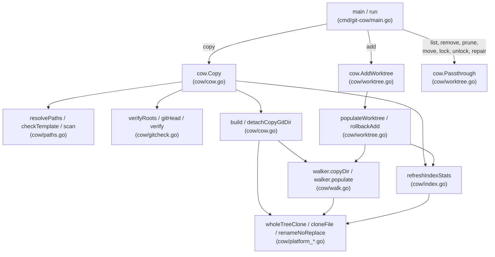
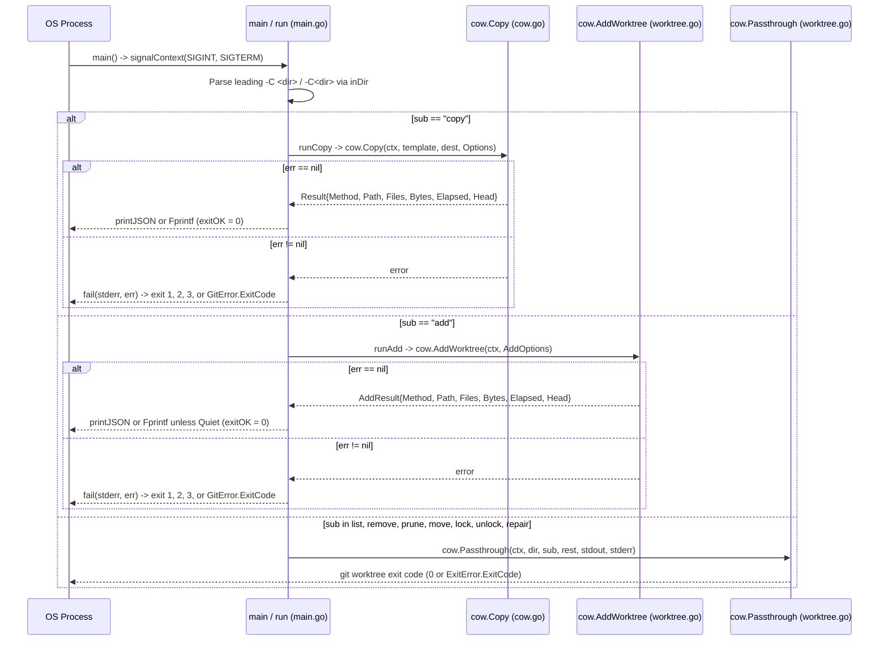
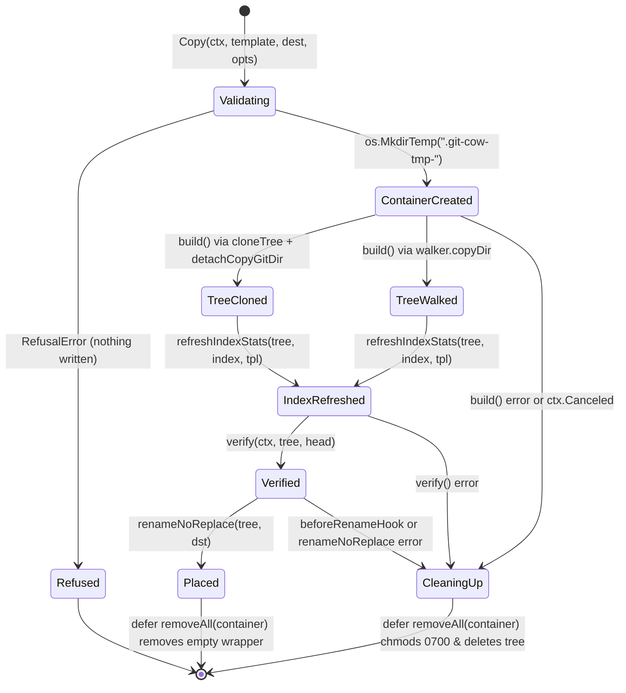
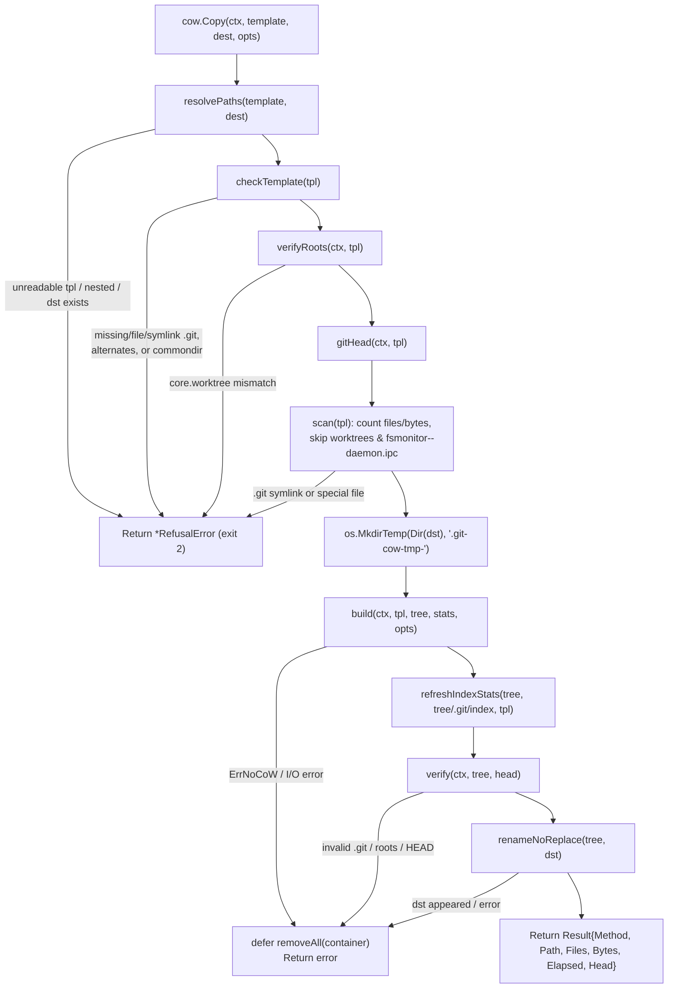
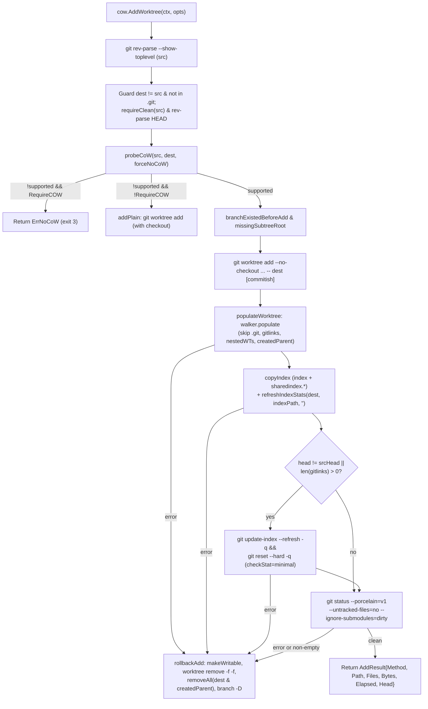
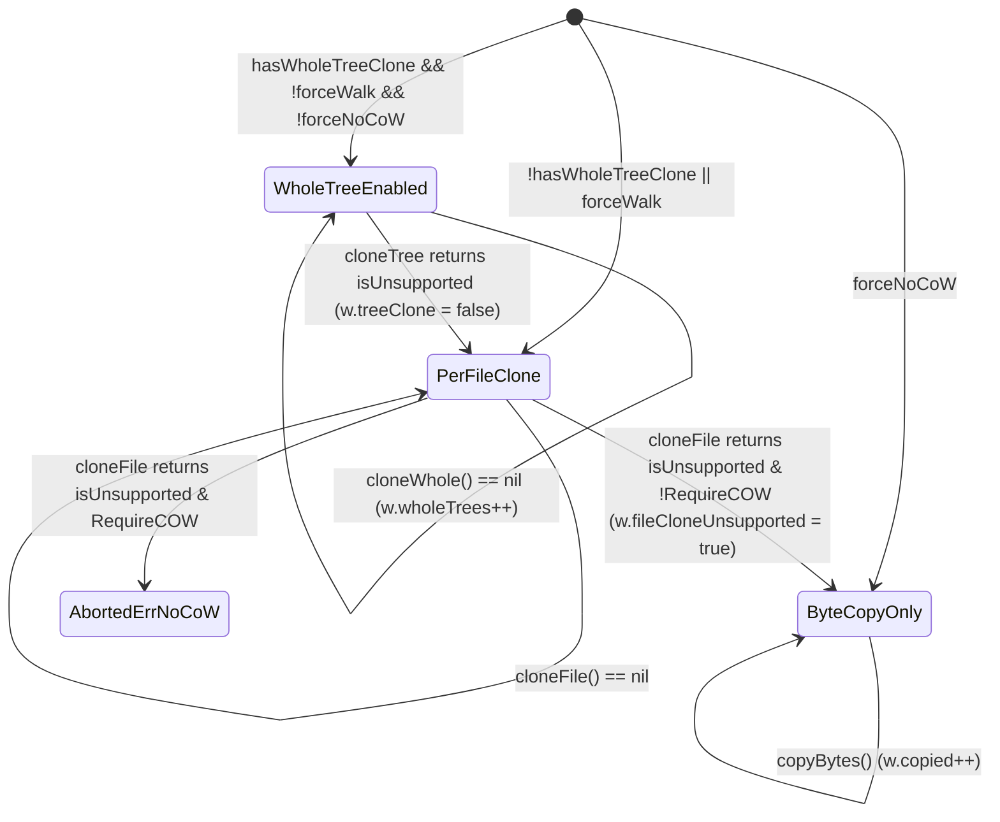
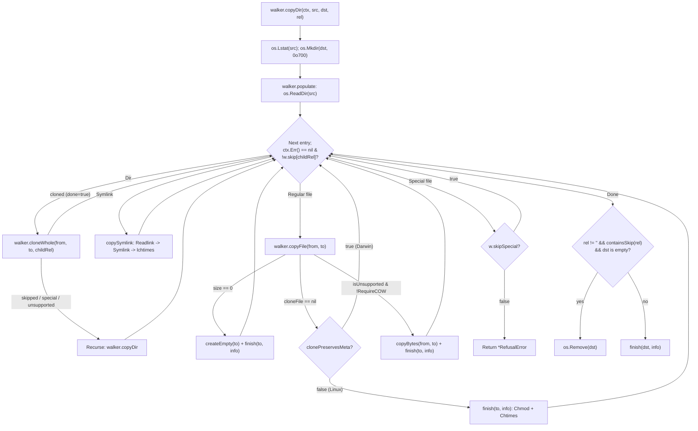
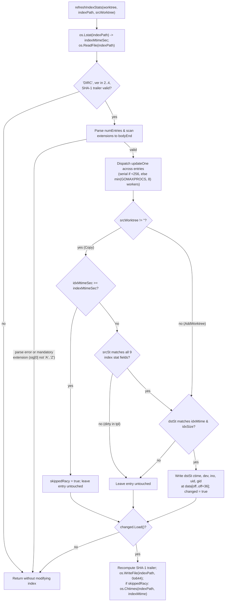

# git-cow Architecture

`git-cow` duplicates Git repositories and linked worktrees using filesystem copy-on-write primitives (`clonefile(2)` on macOS APFS and `FICLONE` on Linux reflink filesystems) while keeping working tree files, Git administrative directories, and binary `.git/index` stat caches consistent. The codebase comprises two packages: `cmd/git-cow` (CLI flag parsing, signal handling, and exit code mapping) and `cow` (the `Copy`, `AddWorktree`, and `Passthrough` pipelines, tree walker, binary index updater, and platform syscall adapters). This document describes the codebase at commit `10b47e7` and pairs with the usage guide in [`README.md`](../README.md).

## Components

The `cmd/git-cow` binary parses leading `-C` flags and dispatches subcommands into the `cow` package, which coordinates isolated `git` subprocesses, the recursive `walker`, the in-place `.git/index` stat updater, and the OS-specific syscall layer.

Each component owns a distinct slice of validation, filesystem mutation, or subprocess execution.

| Component | Location | Owns | Does not own |
| --- | --- | --- | --- |
| `main` / `run` / `runCopy` / `runAdd` / `fail` | `cmd/git-cow/main.go:58-373` | Signal context setup (`SIGINT`, `SIGTERM`), leading `-C` resolution, subcommand flag parsing, JSON/human output formatting, and mapping domain errors to process exit codes (`0`, `1`, `2`, `3`, or `GitError.ExitCode`). | Repository inspection, tree walking, CoW syscalls, or `git worktree` flag validation for passthrough commands. |
| `Copy` / `build` / `detachCopyGitDir` | `cow/cow.go:97-228` | Orchestrating independent repository copies: staging in `.git-cow-tmp-*`, selecting whole-tree `cloneTree` vs. `walker.copyDir`, stripping `.git/worktrees` and `.git/fsmonitor--daemon.ipc`, invoking `refreshIndexStats` and `verify`, and placing the result with `renameNoReplace`. | Low-level CoW syscalls, per-entry directory traversal, or Git subprocess environment construction. |
| `resolvePaths` / `checkTemplate` / `scan` | `cow/paths.go:15-211` | Resolving symlinks on template and destination parents, refusing nested or existing destinations, checking `.git` structure (`alternates`, `commondir`, symlinks), and counting regular files and bytes while refusing special files. | Mutating the filesystem or running `git` subprocesses. |
| `gitHead` / `gitEnv` / `verify` / `verifyRoots` | `cow/gitcheck.go:21-151` | Running sanitized `git rev-parse` subprocesses (`GIT_CONFIG_NOSYSTEM=1`, `GIT_CONFIG_GLOBAL=/dev/null`, `core.hooksPath=/dev/null`, `core.fsmonitor=false`) to verify repository roots and `HEAD` before and after copying. | Executing user-configured hooks or modifying repository state. |
| `AddWorktree` / `populateWorktree` / `rollbackAdd` | `cow/worktree.go:130-671` | Creating linked worktrees via `git worktree add --no-checkout`, probing CoW support (`probeCoW`), populating files with `walker`, copying `index` and `sharedindex.*` (`copyIndex`), running conditional `reset --hard`, and rolling back worktree records, directories, and newly created branches on failure. | Direct CoW syscalls or binary index parsing. |
| `Passthrough` | `cow/worktree.go:676-698` | Forwarding `git worktree ` commands (`list`, `remove`, `prune`, `move`, `lock`, `unlock`, `repair`) with caller stdio streams and returning Git's exit code. | Inspecting passthrough flags or cloning files. |
| `walker` | `cow/walk.go:18-329` | Recursive directory traversal, whole-directory `cloneWhole` attempts, per-file `cloneFile` with fallback to `copyBytes`, symlink recreation (`copySymlink`), special-file skipping/refusal, and empty skipped-directory pruning. | Top-level staging container management or Git metadata verification. |
| `refreshIndexStats` | `cow/index.go:16-303` | Parsing Git dircache (`.git/index`) versions `2`, `3`, and `4`, checking the 20-byte SHA-1 trailer and extension headers, updating stage-0 entry stat fields (`ctime`, `dev`, `ino`, `uid`, `gid`) in parallel via `statIndexFields`, and writing back the re-checksummed index. | Rehashing file contents or modifying mandatory index extensions (`link`, `sdir`). |
| Platform layer | `cow/platform_darwin.go`, `cow/platform_linux.go`, `cow/platform_other.go` | OS-specific CoW primitives (`unix.Clonefile`, `unix.IoctlFileClone`), no-replace renames (`RenameatxNp`, `Renameat2`), symlink timestamp updates (`UtimesNanoAt`), and `unix.Lstat` extraction (`statIndexFields`). | Higher-level retry, fallback, or walk state. |

## CLI Dispatch and Lifecycle

`main` binds a signal-cancelled context before invoking `run`, so an interrupt or termination signal during a copy or worktree population cancels in-flight walks and `git` subprocesses and triggers deferred cleanup before the process exits.

`fail` (`cmd/git-cow/main.go:353-373`) maps errors from `cow.Copy` and `cow.AddWorktree` to four exit statuses: `*cow.RefusalError` returns `exitRefused` (`2`), `cow.ErrNoCoW` returns `exitNoCoW` (`3`), `*cow.GitError` with `ExitCode > 0` returns `gitErr.ExitCode`, and any other error returns `exitError` (`1`).

## Pipeline 1: Independent Repository Copy (`cow.Copy`)

`cow.Copy` (`cow/cow.go:97-165`) builds an independent repository with its own `.git` directory inside a sibling temporary container and renames it into place only after verification succeeds.

### Staging Container State Machine

The destination path `dst` never exists in a partial state: every write happens inside `.git-cow-tmp-*/tree` under `filepath.Dir(dst)`, and `defer removeAll(container)` cleans up the container on both success and failure.

Even if the template contains read-only (`0o500`) directories, `removeAll` (`cow/cow.go:225-228`) walks `container` with `makeWritable` (`os.Chmod(path, 0o700)`) before calling `os.RemoveAll`, preventing stranded temporary trees.

### `cow.Copy` Control Flow

The flowchart below traces `cow.Copy` from path resolution through final placement, including every pre-write refusal and post-copy verification gate.

1. **Resolve and validate paths.** `resolvePaths` (`cow/paths.go:15-53`) resolves symlinks on `template` and on `filepath.Dir(dest)`, refuses via `refusef` if `tpl` and `dst` nest in either direction (`within(tpl, dst)` or `within(dst, tpl)`), and refuses if `os.Lstat(dst)` succeeds.
2. **Inspect template `.git` structure.** `checkTemplate` (`cow/paths.go:67-100`) checks via `os.Lstat` that `tpl/.git` is a real directory and that neither `.git/objects/info/alternates` nor `.git/commondir` exists.
3. **Verify template Git roots and read `HEAD`.** `verifyRoots` (`cow/gitcheck.go:113-151`) runs `git -c core.hooksPath=/dev/null -c core.fsmonitor=false -C <tpl> rev-parse --path-format=absolute --show-toplevel --git-common-dir` under `gitEnv()` (`GIT_CONFIG_NOSYSTEM=1`, `GIT_CONFIG_GLOBAL=/dev/null`, `GIT_TERMINAL_PROMPT=0`, `LC_ALL=C`) and refuses with `*RefusalError` if either path resolves outside `tpl`. `gitHead` (`cow/gitcheck.go:21-48`) runs `git rev-parse --verify --quiet HEAD`, returning `""` on exit status `1` with empty stderr (an unborn branch).
4. **Scan the template tree.** `scan` (`cow/paths.go:112-131`) walks `tpl` via `scanTreeSkip`, skipping `.git/worktrees` and `.git/fsmonitor--daemon.ipc`. It counts regular files and bytes, permits symlinks outside `.git/`, and refuses symlinks inside `.git/` or any FIFO, socket, or device file before anything is written.
5. **Create staging container and build `tree`.** `Copy` creates `container` via `os.MkdirTemp(filepath.Dir(dst), ".git-cow-tmp-")` (`cow/cow.go:128`) and targets `tree := filepath.Join(container, "tree")`. On Darwin (`hasWholeTreeClone == true`), `build` (`cow/cow.go:168-201`) calls `cloneTree(tpl, tree)` (`unix.Clonefile` with `CLONE_NOFOLLOW`) and then `detachCopyGitDir(tree)` (`cow/cow.go:206-209`) to remove `.git/worktrees` and `.git/fsmonitor--daemon.ipc` from the clone. If `cloneTree` is unsupported or disabled, `build` removes any partial `tree` and runs `walker.copyDir` with `.git/worktrees` and `.git/fsmonitor--daemon.ipc` in `w.skip`.
6. **Refresh index stats and verify independence.** `refreshIndexStats(tree, filepath.Join(tree, ".git", "index"), tpl)` (`cow/cow.go:141`) updates non-racy index entries with the copy's new inode numbers. `verify` (`cow/gitcheck.go:69-107`) confirms that `tree/.git` is a directory, `alternates` and `worktrees` are absent, `verifyRoots(ctx, tree)` resolves to `tree` and `tree/.git`, and `gitHead(ctx, tree)` equals the template's `head`.
7. **Atomically place the copy.** `renameNoReplace(tree, dst)` (`cow/cow.go:153`) moves `tree` to `dst` using `RENAME_EXCL` on Darwin or `RENAME_NOREPLACE` on Linux so a concurrent creator of `dst` is never overwritten.

## Pipeline 2: Copy-on-Write Linked Worktree (`cow.AddWorktree`)

`cow.AddWorktree` (`cow/worktree.go:130-188`) delegates worktree registration to `git worktree add --no-checkout`, clones the source working tree (including untracked and ignored build artifacts), updates the worktree index, and rolls back all side effects if population fails.

1. **Validate source checkout and destination.** `AddWorktree` locates `src` via `git rev-parse --show-toplevel` (`cow/worktree.go:133`), normalizes `dest` with `resolveLoose(filepath.Clean(dest))` (`cow/worktree.go:143`), and refuses if `dest == src` or `within(filepath.Join(src, ".git"), dest)`. `requireClean` (`cow/worktree.go:479-491`) runs `git status --porcelain=v1 --untracked-files=no --ignore-submodules=dirty` and refuses with `*RefusalError` if any tracked file is staged or modified.
2. **Probe copy-on-write support.** `probeCoW` (`cow/worktree.go:570-608`) walks up `filepath.Dir(dest)` to the nearest existing ancestor directory and clones `src/.git` (or `src/.git/HEAD` when `src/.git` is a directory) to `.git-cow-probe-<nanos>`, removing the probe immediately. When cloning is unsupported, `AddWorktree` returns `ErrNoCoW` if `opts.RequireCOW` is set, or calls `addPlain` (`cow/worktree.go:274-287`) to run plain `git worktree add`.
3. **Record pre-add branch and directory state.** Before invoking Git, `branchExistedBeforeAdd` (`cow/worktree.go:352-370`) resolves the target branch candidate (`refs/heads/<ResetBranch>`, `opts.Commitish`, or `refs/heads/<Base(dest)>`) with `git rev-parse --verify --quiet --symbolic-full-name` to record whether it already existed under `refs/heads/`. When `dest` lies inside `src` (such as `.worktrees/<name>`), `missingSubtreeRoot` (`cow/worktree.go:409-429`) records the highest non-existent relative directory component (`createdParent`) so the walker skips it and `rollbackAdd` can remove it.
4. **Register the worktree without checkout.** `runGit` executes `addArgs(opts, dest, true)` (`git worktree add --no-checkout ... -- <dest> [<commit-ish>]`, `cow/worktree.go:174, 290-348`), which validates branch constraints and writes `.git/worktrees/<name>` and `dest/.git`.
5. **Clone the working tree.** `populateWorktree` (`cow/worktree.go:192-270`) collects submodule paths from `gitlinkPaths` (`git ls-files --stage -z` matching mode prefix `"160000 "`, `cow/worktree.go:494-510`) and any in-tree linked worktrees from `worktreesInside` (`git worktree list --porcelain -z`, `cow/worktree.go:433-457`). It configures `walker` with `skipSpecial: true` and `w.skip` containing `".git"`, all `gitlinks`, all `nestedWTs`, and `createdParent` (or `rel(src, dest)`), then runs `w.populate(ctx, src, dest, "")`.
6. **Copy and refresh the index.** `copyIndex` (`cow/worktree.go:514-546`) resolves `src` and `dest` index paths with `git rev-parse --path-format=absolute --git-path index` and duplicates `index` plus any `sharedindex.*` split-index base files via `copyOrCloneFile`. `refreshIndexStats(dest, indexPath, "")` (`cow/worktree.go:240`) updates the index stat cache in place with the cloned files' inode and `ctime` values.
7. **Reconcile target commit and submodules.** If `dest`'s `HEAD` differs from `srcHead` or `len(gitlinks) > 0` (`cow/worktree.go:250`), `populateWorktree` runs `update-index --refresh -q` and `reset --hard -q` with `-c core.checkStat=minimal -c core.trustctime=false`, rewriting only the files that differ between `srcHead` and `head` and creating empty submodule directories. A final `git status --porcelain=v1 --untracked-files=no --ignore-submodules=dirty` confirms the worktree is clean.
8. **Roll back on failure.** If any step in `populateWorktree` fails, `rollbackAdd` (`cow/worktree.go:377-404`) runs under `context.Background()`: it resolves `record := worktreeRecord(dest)` (handling relative `gitdir:` paths), reads `<record>/HEAD` to identify any newly created `refs/heads/<branch>` when `!branchExistedBefore`, runs `makeWritable(dest)`, executes `git worktree remove --force --force <dest>` (falling back to `os.RemoveAll(record)` without ever running `git worktree prune`), deletes `dest` and `createdParent`, and deletes `createdBranch` with `git branch -D`.

## Pipeline 3: Tree Walker and Platform CoW Layer (`cow.walker`)

`walker` (`cow/walk.go:18-329`) duplicates a directory hierarchy entry by entry, attempting whole-directory clones where supported and falling back to per-file clones and byte copies.

### Adaptive Fallback State Machine

`walker` tracks two boolean flags (`treeClone` and `fileCloneUnsupported`) so that when a filesystem rejects a whole-tree or per-file clone as unsupported, subsequent directories and files skip the unsupported syscall and its pre-scan.

When `cloneWhole` scans a directory on Darwin and encounters a special file (`special > 0`) while `w.skipSpecial` is true, its `scanTree` callback (`cow/walk.go:165-179`) inserts the special file's slash-separated path into `w.skip`. That makes `w.containsSkip` true for all ancestor directories of the special file on the recursive descent, preventing repeated `scanTree` walks on nested subdirectories while still allowing sibling subdirectories without special files to be cloned with one `cloneTree` call.

### Walker Entry Flow

The flowchart below shows how `walker` processes each directory entry during `copyDir` and `populate`.

### Platform Capabilities

Platform-specific behavior is isolated in `cow/platform_darwin.go`, `cow/platform_linux.go`, and `cow/platform_other.go`.

| Capability / Function | macOS (`cow/platform_darwin.go`) | Linux (`cow/platform_linux.go`) | Other (`cow/platform_other.go`) |
| --- | --- | --- | --- |
| `hasWholeTreeClone` | `true` (`:14`) | `false` (`:14`) | `false` (`:14`) |
| `clonePreservesMeta` | `true` (`:15`) | `false` (`:15`) | `false` (`:15`) |
| `methodFileClone` | `MethodClonefile` (`"clonefile"`, `:16`) | `MethodReflink` (`"reflink"`, `:16`) | `MethodCopy` (`"copy"`, `:16`) |
| `wholeTreeClone(src, dst)` | `unix.Clonefile(src, dst, unix.CLONE_NOFOLLOW)` (`:27-29`) | Returns `errNoCoW` (`unix.EOPNOTSUPP`, `:24-26`) | Returns `errNoCoW` (`:23`) |
| `cloneFile(src, dst)` | `unix.Clonefile(src, dst, unix.CLONE_NOFOLLOW)` (`:32-34`) | Opens `src`, creates `dst` (`O_WRONLY\|O_CREATE\|O_EXCL`, `0o600`), calls `unix.IoctlFileClone`, removes `dst` on error (`:30-50`) | Returns `errNoCoW` (`:26`) |
| `isUnsupported(err)` | `ENOTSUP`, `EXDEV`, `EOPNOTSUPP`, `EINVAL`, `ENOSYS` (`:38-42`) | `ENOTSUP`, `EXDEV`, `EOPNOTSUPP`, `EINVAL`, `ENOTTY`, `ENOSYS` (`:55-59`) | `errors.Is(err, errNoCoW)` (`:29`) |
| `renameNoReplace(old, new)` | `unix.RenameatxNp(..., unix.RENAME_EXCL)`, fallback on `ENOTSUP`/`EINVAL` (`:47-64`) | `unix.Renameat2(..., unix.RENAME_NOREPLACE)`, fallback on `ENOSYS`/`EINVAL`/`ENOTSUP` (`:64-75`) | `os.Lstat` check then `os.Rename` (`:33-39`) |
| `lchtimes(path, t)` | `unix.UtimesNanoAt(AT_FDCWD, path, ts, AT_SYMLINK_NOFOLLOW)` (`:67-71`) | `unix.UtimesNanoAt(AT_FDCWD, path, ts, AT_SYMLINK_NOFOLLOW)` (`:78-82`) | No-op returning `nil` (`:42`) |
| `statIndexFields(path)` | `unix.Lstat(path, &st)` -> `(indexStat, true)` (`:74-91`) | `unix.Lstat(path, &st)` -> `(indexStat, true)` (`:85-102`) | Returns `(indexStat{}, false)` (`:45`) |

## Pipeline 4: In-Place Git Index Stat Refresh (`cow.refreshIndexStats`)

When `clonefile(2)` or `FICLONE` duplicates a file, the clone preserves `mtime` and `size` but receives a newly allocated inode number (`st.Ino`) and status-change timestamp (`st.Ctim`). If `.git/index` retains the source checkout's inode numbers, the next `git status` detects an inode mismatch on every tracked file and reads and SHA-1 hashes the entire working tree. `refreshIndexStats` (`cow/index.go:60-279`) updates the stat cache in `.git/index` directly from `unix.Lstat` on the cloned files.

### Git Index Binary Layout

`refreshIndexStats` parses big-endian Git dircache files (`.git/index`) in versions `2`, `3`, and `4`. Because it modifies only fixed-width `uint32` stat fields inside existing stage-0 entries, entry lengths and byte offsets never shift.

| Region | Byte Offset | Width | Field / Rule |
| --- | --- | --- | --- |
| Header | `0..4` | 4 B | Magic signature `"DIRC"` (`cow/index.go:74`). |
| Header | `4..8` | 4 B | Version `uint32`: `2`, `3`, or `4` (`cow/index.go:78-81`). |
| Header | `8..12` | 4 B | `numEntries` `uint32` (`cow/index.go:89`). |
| Entry (`off`) | `+0..+8` | 8 B | `ctimeSec` (`+0..+4`), `ctimeNsec` (`+4..+8`): **updated to `dstSt`**. |
| Entry (`off`) | `+8..+16` | 8 B | `mtimeSec` (`+8..+12`), `mtimeNsec` (`+12..+16`): verified against `dstSt`. |
| Entry (`off`) | `+16..+24` | 8 B | `dev` (`+16..+20`), `ino` (`+20..+24`): **updated to `dstSt`**. |
| Entry (`off`) | `+24..+28` | 4 B | `mode` (`+24..+28`): skipped if `mode & 0o170000 == 0o160000` (`modeGitlink`). |
| Entry (`off`) | `+28..+36` | 8 B | `uid` (`+28..+32`), `gid` (`+32..+36`): **updated to `dstSt`**. |
| Entry (`off`) | `+36..+40` | 4 B | `size` (`+36..+40`): verified against `dstSt`. |
| Entry (`off`) | `+40..+60` | 20 B | Object SHA-1 OID: never modified. |
| Entry (`off`) | `+60..+62` | 2 B | `flags`: skipped if `flags & 0x3000 != 0` (`ceStagemask`); `0x4000` (`ceExtended`) adds 2 B `extFlags` at `+62..+64` (skipped if `0x4000` `ceSkipWorktree` or `0x2000` `ceIntentToAdd`). |
| Entry path | `+62` or `+64` | var | v2/v3: NUL-terminated path padded to 8-byte alignment from `entryStart`. v4: `readIndexVarint` prefix strip count + NUL-terminated suffix. |
| Extensions | `pos..bodyEnd` | var | Sequence of `[4B sig][4B size][size B]`. Bails out if `sig[0] < 'A' \|\| sig[0] > 'Z'` (mandatory extensions such as `"link"` or `"sdir"`). |
| Trailer | `bodyEnd..end` | 20 B | SHA-1 checksum over `data[:bodyEnd]` (`sha1.Size = 20`). |

### Stat Refresh Flow

1. **Validate header, trailer, and extensions.** `refreshIndexStats` (`cow/index.go:60-189`) stats `indexPath` to capture `indexMtime`, reads the file, verifies the `"DIRC"` magic, version (`2`, `3`, or `4`), and existing 20-byte SHA-1 trailer (which also rejects 32-byte SHA-256 indexes), parses all `numEntries` entries, and walks all extension headers to `bodyEnd`. If any extension has a non-uppercase first byte (`data[pos] < 'A' || data[pos] > 'Z'`, such as `"link"` for split index or `"sdir"` for sparse directory), it returns without modifying the file.
2. **Guard against racy and dirty template entries in `Copy`.** When `srcWorktree != ""` (`cow/index.go:208-224`), `updateOne` applies two checks before touching an entry: if `idxMtimeSec >= indexMtimeSec` (Git's `is_racy_stat` condition), it sets `skippedRacy` and leaves the entry untouched; otherwise it stats the template file (`statIndexFields(filepath.Join(srcWorktree, e.path))`) and requires all nine stat fields (`ctimeSec`, `ctimeNsec`, `mtimeSec`, `mtimeNsec`, `dev`, `ino`, `uid`, `gid`, `size`) to match the index entry. A file modified in the template (even with a same-size edit and forged `mtime`) therefore retains its old index stat entry and is reported as dirty in the copy.
3. **Update stat fields in parallel and re-sign.** For entries whose destination file matches `idxMtimeSec`, `idxMtimeNsec`, and `idxSize`, `updateOne` writes `dstSt`'s `ctime`, `dev`, `ino`, `uid`, and `gid` into `data[off..off+36]`. When `len(entries) >= 256`, up to `min(runtime.GOMAXPROCS(0), 8)` goroutines claim entry indices via `atomic.Int64` (`cow/index.go:240-262`). Finally, `refreshIndexStats` writes the new SHA-1 trailer over `data[bodyEnd:]`, writes `indexPath`, and if `skippedRacy.Load()` is true, restores `indexMtime` on `indexPath` with `os.Chtimes` (`cow/index.go:276-278`) so Git still rehashes the skipped racy entries.

## Concurrency and Signal Handling

`git-cow` runs as a short-lived CLI process with bounded internal concurrency and signal-driven cancellation.

| Execution Context | Created By | State Owned | Synchronization Rule |
| --- | --- | --- | --- |
| Main goroutine | OS process entry (`cmd/git-cow/main.go:58`) | CLI arguments, `walker` counters (`copied`, `wholeTrees`, `files`, `bytes`, `skip`), temporary directory lifecycle, and rollback sequencing. | Runs sequentially; spawns the `refreshIndexStats` worker pool and waits (`wg.Wait()`) before returning. |
| Signal watcher | `signal.NotifyContext` (`cmd/git-cow/main.go:67-69`) | Root `ctx` cancellation channel on `os.Interrupt` (`SIGINT`) and `syscall.SIGTERM`. | Cancels `ctx`; `walker.populate` checks `ctx.Err()` before each entry (`cow/walk.go:100`) and `exec.CommandContext` terminates child `git` processes. |
| `refreshIndexStats` workers (`<= 8`) | `refreshIndexStats` (`cow/index.go:240-262`) | Disjoint 36-byte slices `data[e.offset : e.offset+36]` of the in-memory index buffer, plus shared `next` (`atomic.Int64`), `changed` (`atomic.Bool`), and `skippedRacy` (`atomic.Bool`). | Activated only when `len(entries) >= 256` and `GOMAXPROCS > 1`. Each index `i` from `next.Add(1) - 1` has a unique `entries[i].offset`, so mutations to `data` never overlap. |
| `rollbackAdd` cleanup | `AddWorktree` failure path (`cow/worktree.go:377-404`) | Removal of `dest`, `createdParent`, `.git/worktrees/<name>`, and `createdBranch`. | Uses `context.Background()` (`cow/worktree.go:378`) rather than the caller's `ctx`, so a `SIGINT`/`SIGTERM` cancellation during `populateWorktree` still completes worktree and branch rollback. |
| Package test hooks | `perFileHook`, `cloneTree`, `beforeRenameHook` (`cow/cow.go:79-90`) | Package-level function variables used by tests to inject failures or count `cloneTree` calls. | Nil in production (`cloneTree` defaults to `wholeTreeClone`); mutated only by single-threaded test setup with `t.Cleanup` restoration. |

## Known Gaps

- **Linux `FICLONE` runtime execution.** The Linux platform layer (`cow/platform_linux.go`) is cross-compiled and checked with `GOOS=linux go vet ./...`, and its byte-copy fallback runs on Ubuntu CI (`ext4`), but `unix.IoctlFileClone` has not been timed or executed against a live `btrfs` or `xfs` reflink filesystem in this environment.
- **Mandatory Git index extensions.** `refreshIndexStats` intentionally bails out when `.git/index` contains a mandatory extension (`sig[0] < 'A' || sig[0] > 'Z'`, such as `"link"` for `core.splitIndex` or `"sdir"` for sparse directory entries) or uses 32-byte SHA-256 object IDs. Correctness is preserved because `copyIndex` copies `sharedindex.*` files and Git's own `status` / `update-index` refreshes the index, at the cost of falling back to Git's content hashing for those repositories.
- **Non-Unix platforms (`cow/platform_other.go`).** Platforms other than `darwin` and `linux` compile against `cow/platform_other.go`, which uses byte copies (`MethodCopy`), non-atomic `os.Lstat` + `os.Rename` in `renameNoReplace`, and no-op `lchtimes` and `statIndexFields`.
